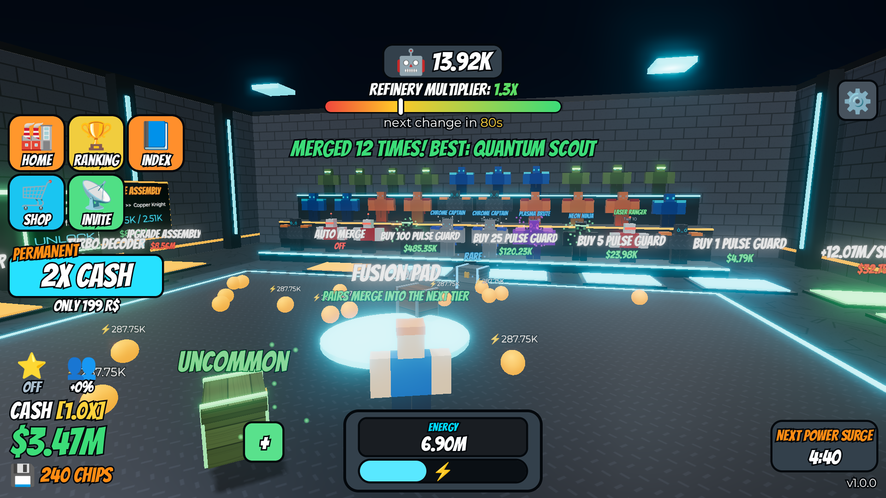
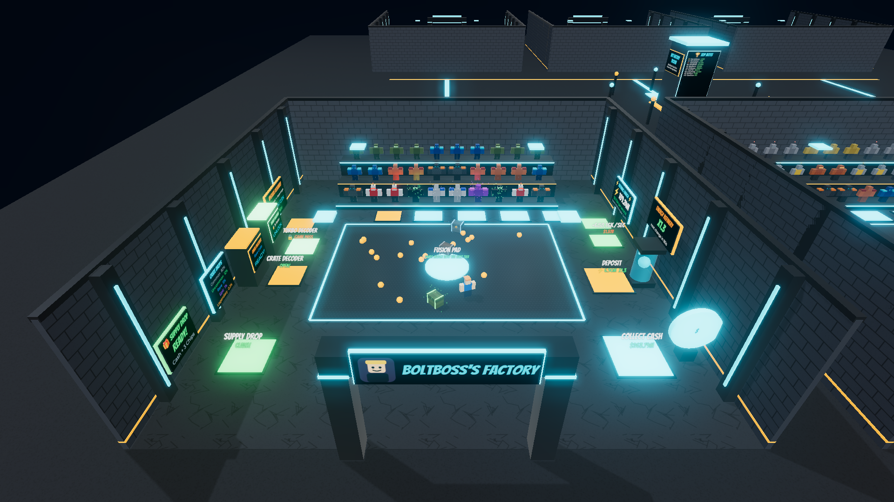
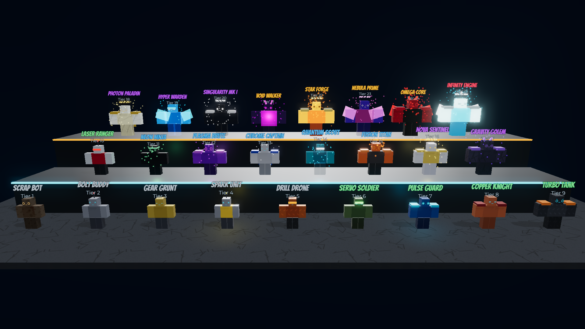
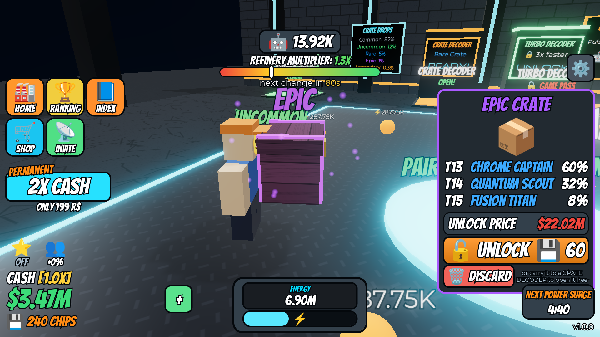
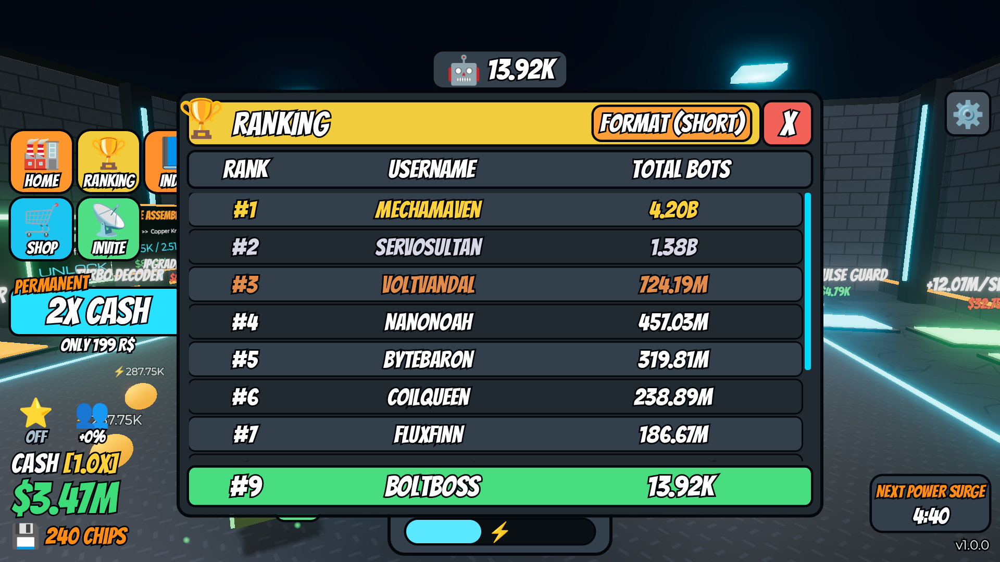
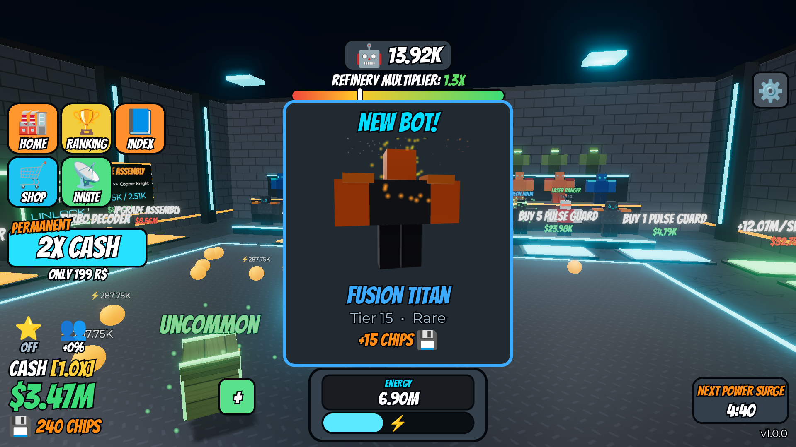

# Merge Tycoon — two ready-to-publish Roblox games

One codebase, two themed games built on a classic merge-tycoon loop. Everything — map, units, UI — is generated by code from parts, so no uploaded assets are needed.

| Variant | Place file | Units (25 tiers) | Orbs | Premium currency |
|---|---|---|---|---|
| **Chad Aura Tycoon** | `build/ChadAuraTycoon.rbxlx` | Normie → Absolute Chad | Aura ✨ | Rizz 💎 |
| **Bot Factory Tycoon** | `build/BotFactoryTycoon.rbxlx` | Scrap Bot → Infinity Engine | Energy ⚡ | Chips 💾 |

## Screenshots

These are preview renders, not captures from Roblox Studio. Roblox can't run headless, so `preview/render.sh` runs the game's real server and client code under Lune, exports the generated world and UI, and renders them with three.js in headless Chromium. Lighting and materials therefore differ a little from Roblox. The layout, units, signs and UI come straight from the game code. All screenshots are in `preview/screenshots/`.

### Chad Aura Tycoon

| | |
|---|---|
|  |  |
|  |  |
|  |  |

### Bot Factory Tycoon

| | |
|---|---|
|  |  |
|  |  |
|  |  |

## How the game plays

1. **Buy units** on the Buy 1 / 5 / 25 / 100 pads. They stand on your display shelves.
2. Units **drop orbs** on the floor every second. Walk over the orbs to fill your tank (bottom of the screen).
3. Step on **Deposit** to send your tank to the converter. The global **multiplier** (0.5x–3x) re-rolls every 20 s, so timing matters.
4. The converter **processes** orbs into cash at your processing speed. Upgrade it on the `+/sec` pads.
5. Step on **Collect Cash** to bank it.
6. **Merge:** two units of the same tier become one unit of the next tier (2.6x the output). Use the merge pad, or buy **Auto Merge**.
7. **Upgrade Buy Tier:** after enough purchases, pay to start buying a higher tier directly (15 buy tiers).
8. **Crates** spawn on your floor (Common → Legendary). Pick one up, then do one of these:
   - unlock it now with cash or premium currency
   - carry it to the **Unlocker** to open it free on a timer
   - discard it

   A crate rolls a unit near your best tier.
9. **Extras:**
   - Index of all 25 tiers, with silhouettes for undiscovered ones and the date you found each one.
   - Global ranking: a leaderboard board in the hub plus a Ranking window with a full/short number format.
   - A free reward every 10 min.
   - Offline earnings, up to 8 h.
   - A global double-orb **Surge** for 2 of every 10 minutes.
   - Friends (+10% each, max +50%) and Premium (+10%) cash bonuses.
   - Settings: music, sound effects, full numbers, auto merge.
10. **Shop:**
    - 5 game passes: Auto Collect Orbs, Auto Cash, Double Orbs, 2X Cash, and a second Unlocker that is 3x faster.
    - 6 cash packs that scale with your income.
    - 3 premium-currency packs.

The server has 6 plots, one per player, arranged around a central hub with a ranking tower.

## Publish a variant (5 minutes)

1. Open `build/ChadAuraTycoon.rbxlx` (or `BotFactoryTycoon.rbxlx`) in Roblox Studio. The map builds itself when you press **Play**.
2. **File → Publish to Roblox**.
3. **Game Settings → Security → Enable Studio Access to API Services** so saving and the ranking work.
4. Monetization: create the game passes and developer products on the Creator Dashboard. Paste their IDs into `src/themes/<variant>/Theme.luau` (`Theme.Monetization`) and rebuild (see below).
   - While an ID is `0`, buying it in Studio grants it for free, so you can test every feature.
   - On live servers, an item with ID `0` shows "coming soon".
5. Optional: set `Theme.MusicId` to an audio asset you own.

## Develop

Toolchain versions are pinned in `rokit.toml`: Rojo, Selene, StyLua, Lune and luau-lsp.

```sh
rokit install                 # install the pinned tools
scripts/check.sh              # format check, lint, type-check, tests, build both places
rojo serve chad.project.json  # live-sync into Studio (or bot.project.json)
lune run scripts/simulate     # print the progression curve of a greedy player
```

### Layout

```
chad.project.json / bot.project.json   Rojo projects (identical except for the Theme module)
src/shared/Economy.luau                every balance number + pure formulas (unit-tested)
src/shared/Format.luau                 number/time formatting (unit-tested)
src/shared/CharacterFactory.luau       builds the blocky unit models from a theme "look"
src/shared/Net.luau                    remotes
src/server/WorldBuilder.luau           generates hub + 6 plots
src/server/Tycoon.luau                 core loop: pads, orbs, crates, merging, processing, state
src/server/DataService.luau            DataStore profiles (retries, no-overwrite on failed load)
src/server/Monetization.luau           passes, products, receipt handling
src/server/Ranking.luau                OrderedDataStore leaderboard
src/client/                            HUD, Shop / Index / Ranking / Settings, popups, sounds
src/themes/chad|bot/Theme.luau         names, words, colours, fonts, lighting, 25 tiers, product IDs
tests/run.luau                         Lune unit tests (economy, formatting, both themes)
preview/                               screenshot pipeline (Lune exporter + three.js/Chromium renderer)
reference/                             the original reference screenshots
```

### Add a third theme

1. Copy `src/themes/chad` to a new folder and edit the names, colours and 25 tier looks.
2. Copy `chad.project.json`, point its `Theme` entry at the new file, and add the variant to `scripts/check.sh`.

Gameplay balance is shared, so you only tune it once, in `Economy.luau`.
