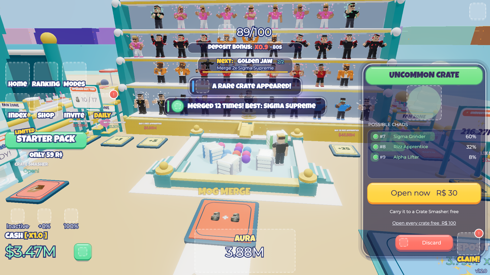
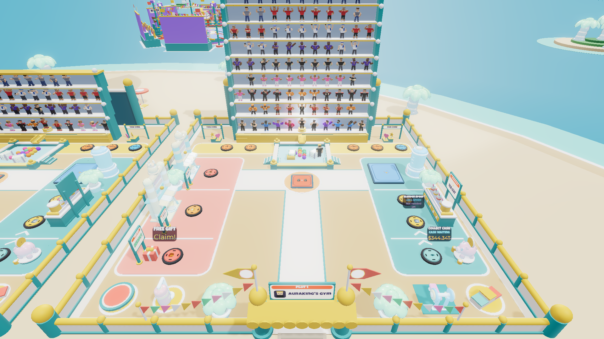
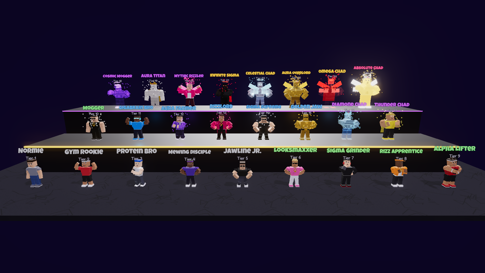
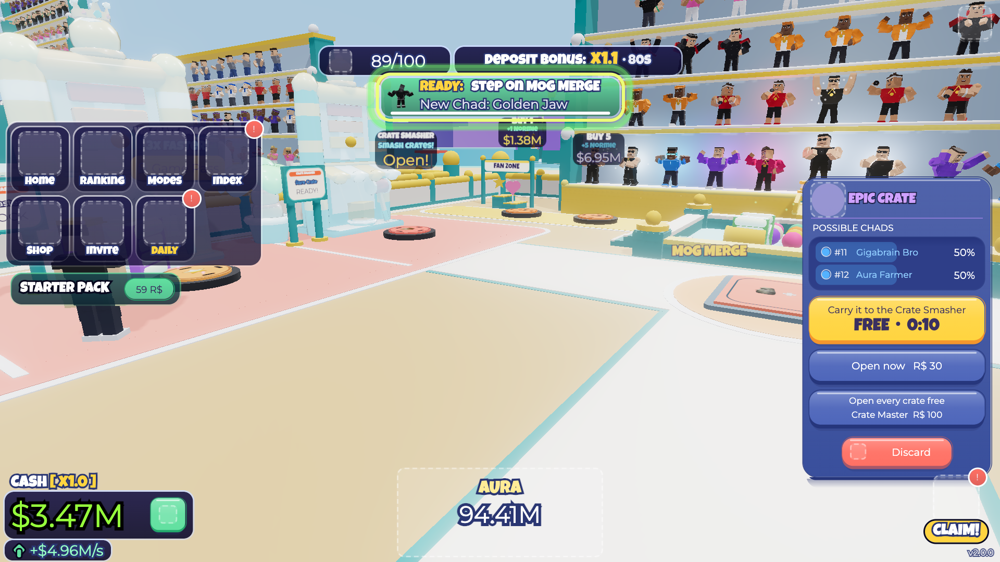
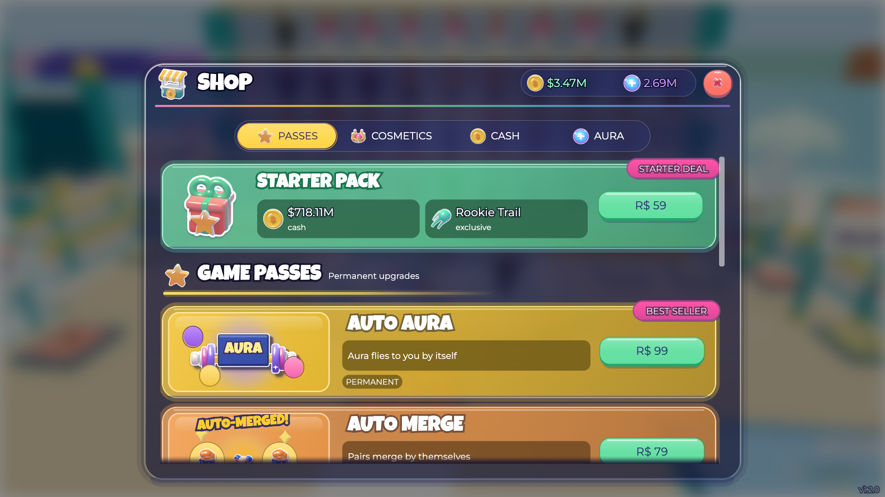
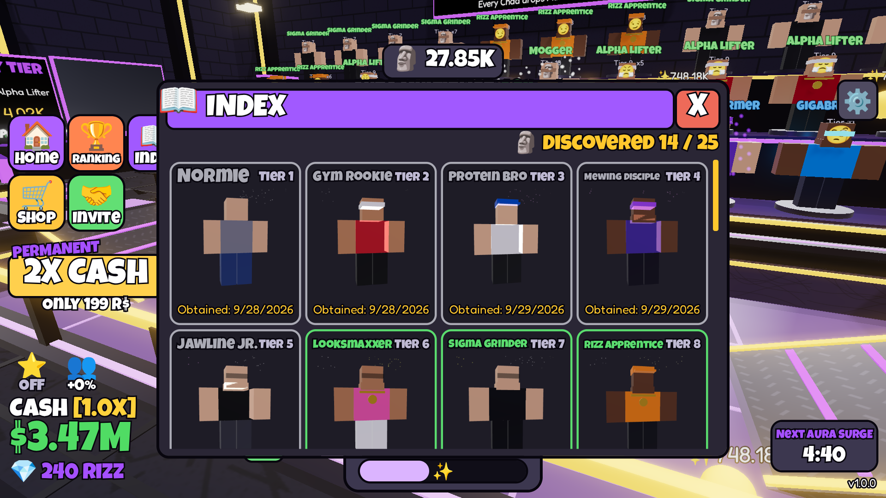
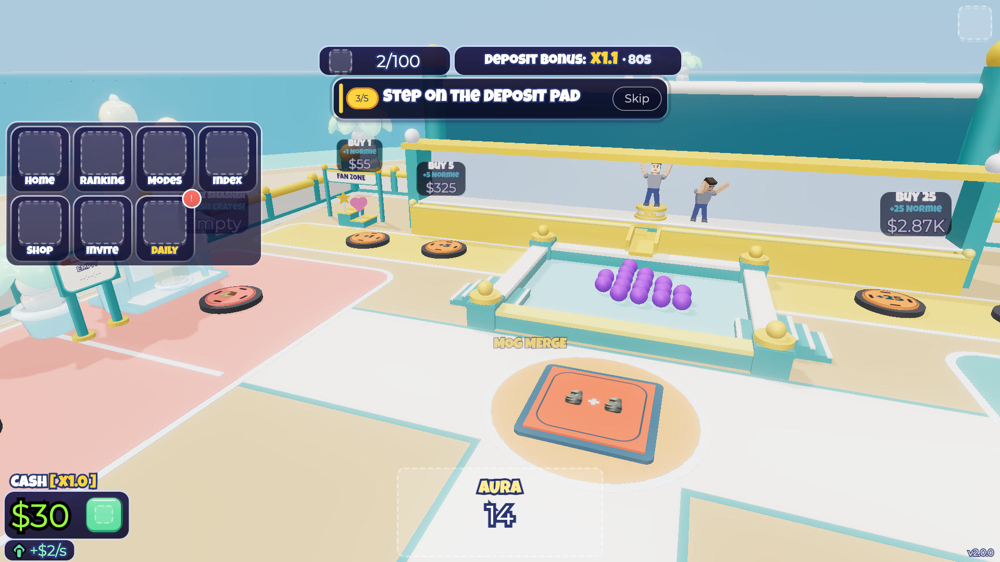
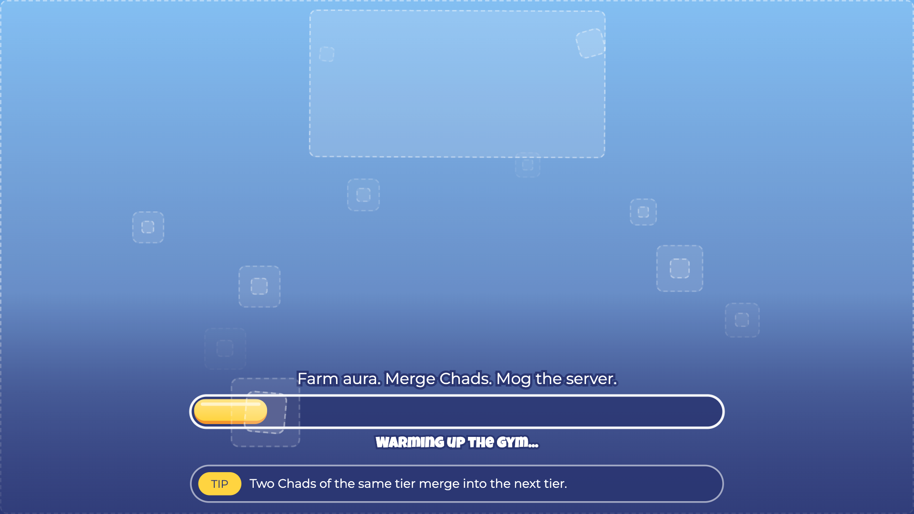

# Chad Aura Tycoon

A kids' merge tycoon on a sunny muscle-beach gym. Chads stand on a rack, drop aura orbs into a pen,
and fans cheer them on. The map, the units and the UI are generated by code at server start. The look
comes from Blender-made art (meshes, sprites, icons, faces, HUD and brand art) uploaded through the
pipeline in [docs/assets.md](docs/assets.md). Every uploaded prop has a part-built fallback, so the game
still works while an asset is missing or in moderation.

| Place file | Units (25 tiers) | Orbs | Universe / place |
|---|---|---|---|
| `build/ChadAuraTycoon.rbxlx` | Normie → Absolute Chad | Aura | `deploy/target.json` |

## Screenshots

These are offline preview renders from `preview/`, not Roblox captures, and they may lag behind the game.
`preview/render.sh` runs the real server and client code under Lune, exports the world and UI, and draws
them with three.js in headless Chromium, so lighting and materials differ a little from Roblox. All renders
are in `preview/screenshots/chad/`.

| | |
|---|---|
|  |  |
|  |  |
|  |  |
|  |  |

## How the game plays

Six plots (one per player) sit around a hub plaza with a golden Chad statue and two ranking boards, on a
sand island in the sea.

- **Intro cutscene.** New players watch a 15-second story once (`profile.introSeen`), starring their own
  Roblox avatar: the hero curls a candy dumbbell while his #1 fan cheers, MAX GIGA CHAD strides in and the
  fans leave with him, the hero sits under a rain cloud, gets the idea, and the camera flies to the
  player's real plot. The Skip button is on screen from the first frame (Esc and gamepad B or A skip
  too). Server: `src/server/Intro.luau`; client: `src/client/Intro/*`.
- **Tutorial.** A slim, skippable checklist of 5 steps: buy a unit, pick up orbs, deposit, collect cash,
  merge. A quest pill under the top HUD and a small bobbing chevron over the target show the current
  step. Each step completes on the real server event. The tutorial's deposit turns into cash at once,
  and finishing pays $200.
- **First minutes.** A new player starts with $100 and a level 16 converter (`Economy.START_CASH`,
  `START_PROCESS_LEVEL`), and the first 60 units bought are cheap ($50, then +$5 each;
  `Economy.BUY_EASY_UNITS`). Following the tutorial at
  walking pace this gives tier 2 after about 20 s, tier 3 after 30 s, tier 5 by 3 minutes and tier 6 by
  5 minutes, with something to buy on every lap (`lune run scripts/simulate --first`). From then on
  every unit bought adds $50 to the price of the next. The buy pads always sell the first tier; higher
  tiers come from merging and crates. Saves from when the buy tier could be upgraded start just past
  the 60 cheap units.
- **Rack.** Units stand on a display rack of up to 10 shelves and 100 slots (`Economy.UNIT_CAP`), each
  with a name plate that glows more at higher tiers. Two units of a tier merge into one of the next tier
  (2.2x output) on the Merge pad or with the Auto Merge game pass. At the cap, a new unit first auto-merges
  the lowest pair; units are refused only when nothing can merge. The HUD shows "37/100", or "RACK FULL"
  when the rack is full.
- **Orbs.** Each unit drops orbs that hop off its shelf, roll along the gutter and down the chute into the
  walled pen as balls coloured by tier. The pen holds 64 balls (`OrbLook.CAP`); after that new orbs count
  up existing balls (an "xN" tag). Walk into the pen (stairs on both sides) to collect them into the
  dumbbell at the bottom of the HUD.
- **Pads** fire the moment you step on them (once per visit). Walking in from the hub: Buy 1,
  Buy 5 on the left of the pen and Buy 25, Buy 100, Auto Merge on the right, all along the foot of the
  rack; Merge in front of the pen; on the right, the `+/sec` upgrades (x1, x10), the big Deposit pad by
  the blender converter and Collect by the vault; on the left, the Crate Smasher, the VIP Smasher and the
  Free gift. Positions: `Layout.PADS` in `src/server/PlotLayout.luau`.
- **Deposit bonus.** Depositing sends your aura to the blender, which turns it into cash at your
  processing speed. The global deposit multiplier (x0.5 to x3) re-rolls every 20 s and shows under the
  unit count as "Deposit bonus: x1.3 · 12s". Collect the cash on the Collect pad.
- **Aura Surge.** The last 2 minutes of every 10 double all orbs. The strip turns orange ("AURA SURGE
  x2"), the client adds a warm golden-hour grade, soft bloom, sun rays and drifting gold sparkles, and the
  music cross-fades to the surge playlist (`src/client/Fx/Surge.luau`, `Theme.SurgeMusicId`).
- **Crates** (Common to Legendary) slide down the same chute into the pen. Walk into one to pick it up
  (within 4.5 studs, one at a time; `src/shared/CratePickup.luau`). Crates hold units around half-way
  between tier 1 and your best tier (`Economy.chestAnchor`), so they help without skipping the curve. The
  crate panel shows the odds for your best tier and offers:
  - **Open now** with the "Open Crate" product (R$ 30, any rarity), or free and instant with the
    **Crate Master** pass. Both are offered only where `PolicyService` allows paid random items.
  - Carry it to the **Crate Smasher** to open it free on a timer (the VIP Smasher pass is 3x faster).
    Smashing it before the timer ends takes the same "Open Crate" product, or is free with Crate Master.
  - **Discard** it.
- **Fans** are wholesome cheering fans around each plot: 3 + half your best tier, up to 12 on your own
  plot and 4 on others. They run in, clap, wave signs and cheer when you buy or merge.
- **Cosmetics** (`src/server/Cosmetics.luau`): Speedy Sneakers, Double Jump, Rainbow / Star / Rookie
  trails, Chad Aura and Golden Crown. Each has its own pass (the Rookie Trail comes only with the Starter
  Pack), and the All Cosmetics Pack unlocks every non-Starter item. The **Starter Pack** gives a one-time
  hour of income (at least 10,000) plus the Rookie Trail.
- **Game Modes.** A plaza on the hub has three gates, each a teleport portal
  (`src/server/GameModes.luau`, `src/server/Modes/*`). **Parkour** is a rainbow **sky obby**: the ten
  themed maps (Sunny Steps, Coconut Cove, Sweeper Bay, Blink Reef, Bubble Bounce, Coral Climb, Shark Fin
  Sprint, Thunder Tide, Volcano Vault, Giga Gauntlet; `Course.MAPS`, see
  [docs/sky-obby.md](docs/sky-obby.md) and [docs/parkour-maps.md](docs/parkour-maps.md)) are chained
  end to end high above the clouds, with 70 numbered stages on blue arrow pads, rainbow tiles (square,
  ring, hex, discs, beams, stairs), floating islands with landmarks, windmills, balloons and a cloud
  floor; falling lands on the cloud catch volume and respawns you at your stage. Walking through gate 1's
  portal, CHOOSE MAP in the Modes window or "Choose map" on the finish card opens the **map picker**
  (`src/client/UI/MapPicker.luau`, a live 3D preview per map). During a run the HUD shows a rainbow
  progress bar with every runner's avatar head, "STAGE n / 70", **SKIP STAGE** (cash: two minutes of income, at least $250, `ParkourSkip`)
  and a 3-slot **gear hotbar** (Speed, Jump and Gravity coils, keys 1-3, `ParkourGear`): gear and skips
  make the run "assisted" (it pays, unlocks and counts clears but never sets a best time or board entry).
  The Ranking window has a STAGE board. Unit tests check every jump on every map is fair for the default
  jump. Maps unlock in order, bests, clears and the best stage are saved, and a finish pays 5 minutes of
  income (at least 750, `Theme.Modes.Reward`) times a per-map bonus (`Economy.parkourLevelBonus`) on the
  first clear of a map and then at most once per
  cooldown. **Mog Test** is a skill-check duel on a floating stage
  (`Modes/MogRules.luau`, `Mog.luau`, `World/MogStage.luau`, `UI/MogHud.luau`, `Fx/Mog.luau`): press
  Space / click / tap / A when the needle is in the zone; the window shrinks and the needle speeds up every
  check; mogging 3 rivals passes the test and pays the mode reward, then the run goes on for a high score
  with 3 lives. Entering asks **vs rivals** (that run) or **PvP**: a 1v1 against a real player from a
  45 s queue, both answering the same checks with 8 HP each (hit 1 damage, perfect 2, a miss hurts yourself;
  a KO tie goes to sudden death). The winner gets the mode reward; leaving mid-duel forfeits. PvP wins and
  duels fought are saved, but only PvE scores go on the TOP MOGGERS board. Gate 3 is **Cardio**, a keyboard runner (`docs/cardio.md`):
  build Speed, run ten stages, and cash out only by stepping on a safe zone's WIN plate (deeper plates pay
  more); a fall or a chaser's catch sends you back to stage 1.
- **Shop packs scale with progression.** Cash packs pay 15 min / 1 h / 5 h / 24 h of your income and aura
  packs put 15 min / 1 h / 5 h / 24 h of your aura production straight into your tank, each with a minimum
  per pack (`Economy.progression`). The shop shows each player
  the same amounts the server grants.
- **HUD** (`src/client/UI/Hud.luau`), laid out like the owner's reference game: chunky icons and outlined
  text straight over the world. Settings gear top right; unit count and deposit strip top centre; icon grid
  (Home, Ranking, Modes, Index, Shop, Invite, Daily) and a 2X CASH / Starter Pack promo on the left; cash
  and bonuses bottom left; the Blender dumbbell with the carried aura bottom centre; the free gift bottom
  right.
- **Next goal.** Once the tutorial is done, a small strip under the deposit strip (above the dumbbell on
  short screens) names the next target and how far along it is: "Next: Protein Bro 1/2" over "Merge 2x Gym
  Rookie", with the target's silhouette and a thin progress bar; tapping it opens the Index. The target is
  the next undiscovered tier, then filling the rack with the top tier
  (`src/shared/NextGoal.luau`). It hides during the intro and game-mode runs.
- **Daily reward** (`src/shared/DailyReward.luau`, `src/server/Daily.luau`, `src/client/UI/DailyWindow.luau`):
  one claim per UTC day on a 7-day streak. Each day pays cash sized like a shop cash pack (minutes of your
  income, with a minimum), days 3 and 7 also open a crate on the spot. Missing a day restarts at Day 1; after
  Day 7 the cards loop and the streak keeps counting.

  | Day | 1 | 2 | 3 | 4 | 5 | 6 | 7 |
  |---|---|---|---|---|---|---|---|
  | Income | 5 min | 10 min | 15 min | 20 min | 30 min | 45 min | 60 min |
  | At least | $250 | $500 | $1,000 | $2,000 | $4,000 | $8,000 | $15,000 |
  | Also | | | Rare crate | | | | Legendary crate |

  A player's first day is capped: Day 1 pays at most the price of their next 4 units (`DailyReward.firstDayCap`,
  about $250-$450 in the first minutes, never below the $250 minimum), a boost that does not skip the first
  tiers. From the second day on the table applies as it is. If the rack has no room for a crate's unit, the
  crate is paid as cash instead (what its unit is worth on average) and a toast says so.

  The Daily window shows the seven cards (claimed ones ticked, today's glowing, tomorrow's with "Come back
  tomorrow" and a countdown). It opens by itself once per session when a reward is waiting, never during the
  intro, the tutorial or a game-mode run; a held crate makes it wait up to 10 s, then it opens anyway. The
  HUD's Daily button shows a dot while a reward waits and the countdown otherwise. On a player's first day, a few minutes in, one toast says "Come back tomorrow for
  Day 2: ...".
- **Extras:** Index of all 25 tiers, global ranking, a free gift every 10 minutes, offline earnings up to
  8 h, friend (+10% each, max +50%) and Premium (+10%) bonuses, settings, and a loading screen.
- **Badges** (`src/server/Badges.luau`, ids in `Theme.Badges`): Welcome to the Gym, Gym Graduate (tutorial
  finished, not skipped), Certified Chad (tier 10), Absolute Chad (tier 25) and Parkour Master (level 10).
  `tools/badges.py ensure` creates missing ones from `art/out/badges/<Key>.png` (rendered by
  `art/blender/badges/`).
- **Analytics** (`src/server/Analytics.luau`, steps in `src/shared/Funnel.luau`) for the Creator Dashboard:
  the onboarding funnel, logged once per new player (1 Joined, 2 Intro Done, 3-7 the tutorial steps, then
  8 Tier 3, 9 Tier 5, 10 Tier 7, 11 Tier 10 for the highest tier discovered), a recurring "Shop" funnel
  (Opened, Prompted, Purchased) and custom events. "TutorialSkipped" ends the funnel for that player, so
  the tutorial steps stay honest; their tier milestones are logged as "SkipperTier3" / "5" / "7" / "10"
  instead (everyone who reached a tier = the funnel step plus the Skipper event). Saves from before the
  tier milestones whose tutorial was over are marked as past all four and send nothing. "IntroSkipped" and
  "IntroWatched" carry the seconds of the intro that played. Use them to judge ad traffic: where new
  players stop and how many shop visits end in a purchase.

## Publish

All passes and products exist on the universe and their ids are in `Theme.Monetization`
(`src/themes/chad/Theme.luau`). Prices (R$):

| Kind | Item (theme key) | R$ |
|---|---|---|
| Pass | Auto Aura (`AutoLoot`) | 99 |
| Pass | Auto Cash (`AutoCash`) | 49 |
| Pass | Double Aura (`DoubleAura`) | 299 |
| Pass | 2X Cash (`DoubleMoney`) | 199 |
| Pass | VIP Smasher, 3x faster (`PremiumUnlocker`) | 149 |
| Pass | Crate Master (`CrateKey`) | 100 |
| Pass | Speedy Sneakers / Double Jump | 79 each |
| Pass | Rainbow Trail / Star Trail | 49 each |
| Pass | Chad Aura (`AuraGlow`) | 99 |
| Pass | Golden Crown (`Crown`) | 129 |
| Pass | All Cosmetics Pack (`AllCosmetics`) | 299 |
| Pass | Starter Pack (`StarterPack`) | 59 |
| Product | Open Crate (`CrateOpen`) | 30 |
| Product | Cash packs 1-4 (`MoneyPacks`) | 49, 199, 499, 1000 |
| Product | Aura packs 1-4 (`AuraPacks`) | 49, 199, 499, 1000 |

If a price changes on the dashboard, change `Price` in the theme too (the buttons show it). An id of `0`
is granted for free in Studio and shows "coming soon" on live servers. `tools/monetization.py` creates and
lists items (see Develop).

Still to do by the owner in the Creator Dashboard:

1. The experience questionnaire: declare that the game sells **paid random items** (crates; the odds are
   shown in the crate panel).
2. **Places → Max Players: 6** (one plot per player; a 7th player is told the server is full). Done.
3. Upload the **icon and thumbnails** (`marketing/` and `preview/screenshots/` are starting points). The icon
   and one thumbnail are live; add more thumbnails before running ads.

Also enable Studio Access to API Services for testing saves in Studio. Saves are session-locked
(`src/shared/SessionLock.luau`), so a fast server hop never overwrites progress.

## Develop

Tool versions are pinned in `rokit.toml` (Rojo, Selene, StyLua, Lune, luau-lsp).

```sh
rokit install                            # install the pinned tools
scripts/check.sh                         # format check, lint, type-check, unit tests, build build/ChadAuraTycoon.rbxlx
scripts/lint-files.sh src/a.luau [...]   # the same checks on just these files (work in progress)
rojo serve chad.project.json             # live-sync into Studio
lune run scripts/simulate                # when a greedy no-pass player reaches each tier (600 h)
lune run scripts/simulate --first        # a new player's first 10 minutes, in seconds (tutorial, then the loop)
lune run scripts/simulate --extras --aura --cash   # with free reward, parkour, surge, crates and passes
preview/render.sh                        # regenerate preview/screenshots/chad/
```

`preview/render.sh` needs rojo, lune, Node 18+ and a Chromium `headless_shell`: set `CHROME=/path/to/headless_shell`
when it is not at the Playwright default. `REUSE_THUMBS=1` keeps existing unit thumbnails and
`ONLY=pen,hub` renders only shots whose name contains one of the words.

Art and monetization (details in [docs/assets.md](docs/assets.md)):

- `tools/blender-run.sh art/<area>/<script>.py [-- args]` runs headless Blender in one slot of the
  machine-wide heavy-job pool.
- `python3 pipeline/upload.py <domain> | --all [--check]` uploads `art/assets/<domain>.json`, pins ids in
  `assets/pins.json` and regenerates `src/shared/Assets.luau`; `python3 pipeline/gen_assets.py [--check]`
  regenerates it by hand.
- `python3 tools/monetization.py list | ensure-product | ensure-pass | update-product | update-pass` manages
  passes and products for the universe in `deploy/target.json`.

Studio capture tools (macOS; need Screen Recording and Accessibility):

- `tools/studio.py <tool> ['<json>']`: client for Studio's built-in MCP server (e.g. `execute_luau`).
- `tools/studio-open.py <place.rbxl> --tag NAME`: opens a TestBench copy without a click;
  `--close NAME` closes it.
- `tools/studio-shot.py --shots shots.json --out sheet.png`: runs Luau and captures camera shots into a
  contact sheet.
- `tools/studio-window-shot.py --out shot.png --match TEXT`: background window capture (also `--burst`
  and `--sheet`). The `tools/studio-*.swift` helpers and `tools/studio_window.py` drive the windows.

Studio-only debug hooks (ignored on live servers), set as Player attributes from Studio, for example
through `tools/studio.py execute_luau`:

- `DebugGrant` (set by a server script): `"cash,<n>"`, `"units,<total>"`, `"pass,<Name>"`,
  `"crate"` or `"pickup"`.
- `IntroPreview` (on the LocalPlayer): `"<beat>,<pauseSeconds>"` replays the intro paused in that beat;
  `"skip"` ends it.
- `UiPreview` (on the LocalPlayer): `"<WindowName>"`, `"Shop,<focus>"`, `"close"`, `"starter"` or
  `"reward,<tier>"`.

### Layout

| Path | What it is |
|---|---|
| `chad.project.json` | Rojo project (maps `assets/models` into `ReplicatedStorage.AssetModels`) |
| `src/themes/chad/Theme.luau` | Names, words, palette (`Theme.World`), fonts, lighting, 25 tiers, fans, cosmetics, monetization ids |
| **src/shared** | |
| `Economy.luau` | Every balance number and pure formula (unit-tested) |
| `Format.luau` | Number and time formatting |
| `Net.luau` | Remotes (State, Notify, actions) |
| `OrbLook.luau` | Orb colour per tier, the pen fill rule (64 balls), Auto Aura and roll-in timing |
| `CratePickup.luau` | Walk-in crate pickup rules (radius, landing time, re-arm) |
| `Assets.luau` | Generated asset ids (`pipeline/gen_assets.py`; do not edit) |
| `AssetModels.luau` | Clones of the uploaded Blender models, nil when missing |
| `CharacterFactory.luau` | Builds the part-built unit rigs from a theme look |
| `Poses.luau`, `RigPose.luau` | Procedural pose library and its application to a rig |
| `SessionLock.luau` | DataStore session-lock decisions |
| `DailyReward.luau` | Daily reward rules: UTC days, the streak, the 7 rewards (unit-tested) |
| `NextGoal.luau` | Picks the HUD's "Next:" goal (unit-tested) |
| `TutorialSteps.luau` | Tutorial steps and their rules |
| `Funnel.luau` | Onboarding funnel steps and what each profile logs next |
| **src/server** | |
| `Main.server.luau` | Entry point: builds the map, wires services, join/leave/saving |
| `Tycoon.luau` | Core loop: pads, orbs, crates, merging, processing, state, debug hook |
| `WorldBuilder.luau` | Builds the hub and the 6 plots from the `World/*` modules |
| `PlotLayout.luau` | Plot-local geometry: rack, gutter, chute, pen, pads, machines, fan zones (unit-tested) |
| `World/Common.luau` | Constants and part/label/billboard primitives |
| `World/Shell.luau` | Plot ground, boundary, entrance and sign cards |
| `World/Shelves.luau` | The display rack |
| `World/Pen.luau` | Orb pen, its stairs, gutter and chute |
| `World/Pads.luau` | Step-on pads and their signs |
| `World/Machines.luau` | Smoothie-blender converter, juice-bar processor, piggy-bank vault, high-striker crate smashers |
| `World/Decor.luau` | Gym dressing, entrance path, fan zones |
| `World/Hub.luau` | Lighting, island and sea, hub plaza |
| `World/Modes.luau`, `World/MogStage.luau` | Game Modes plaza, the 10 Parkour levels, the Mog stage |
| `World/Props.luau` | Swaps part-built props for uploaded Blender meshes when present |
| `GameModes.luau` | Game mode registry and shared plumbing |
| `Modes/Catalog.luau`, `Course.luau`, `Rules.luau`, `Parkour.luau` | Mode list, level layouts and generator, run rules, Parkour |
| `Modes/MogRules.luau`, `MogLayout.luau`, `Mog.luau` | Mog Test rules (unit-tested), stage layout, the mode |
| `Cosmetics.luau` | Cosmetic passes and the Starter Pack |
| `Intro.luau` | Saves whether the intro was seen |
| `Tutorial.luau` | Tutorial progress and reward |
| `Daily.luau` | Daily reward claims, the State snapshot's `daily` field, the first-day toast |
| `Monetization.luau` | Passes, products, receipts, paid-random-items policy |
| `DataService.luau` | DataStore profiles (retries, no overwrite after a failed load) |
| `Ranking.luau` | OrderedDataStore leaderboard |
| **src/client** | |
| `Main.client.luau` | Entry point: builds the UI, routes server messages, Studio preview hooks |
| `State.luau` | Latest server snapshot |
| `UI/Kit.luau` | UI design system (buttons, panels, icons, windows) |
| `UI/Hud.luau` | Always-on HUD |
| `UI/Windows.luau` | Shop, Index, Ranking, Settings, Game Modes |
| `UI/DailyWindow.luau` | Daily Reward window (opens by itself once per session) |
| `UI/Popups.luau` | Toasts, reward reveals, crate panel, dialogs, offline earnings |
| `UI/Tutorial.luau` | Tutorial quest pill and completion banner |
| `Guide.luau` | Bobbing chevron that points at a target |
| `Animator.luau` | Unit animations on the rack and in viewports |
| `Sounds.luau` | Sound effects and music (surge mood) |
| `Fx/Orbs.luau`, `Fx/Crates.luau` | Orb and crate roll-in and pickup |
| `Fx/Shelf.luau`, `Fx/Plates.luau`, `Fx/PlateStyle.luau` | Rack juice and unit name plates |
| `Fx/Machines.luau` | Converter, processor and cash animation |
| `Fx/Fans.luau` | The fan club |
| `Fx/Surge.luau` | Aura Surge look and music mood |
| `Fx/Ambient.luau` | Idle sway and bob for the map |
| `Fx/Camera.luau` | Spawn framing, camera punch and shake |
| `Fx/Cosmetics.luau` | Local double jump and speed puffs |
| `Fx/Modes.luau` | Moving obstacles, blink pads and the Parkour client |
| `UI/MogHud.luau`, `Fx/Mog.luau` | Mog Test ring, hearts and duel camera / rival |
| `Fx/Sprites.luau` | Blender effect sprites |
| `Intro/Cutscene.luau`, `Timeline.luau` | Plays the intro; the story as data |
| `Intro/Stage.luau`, `Actors.luau`, `Effects.luau` | Intro set, cast and effects |
| `Intro/Avatar.luau`, `AvatarRig.luau` | The player's avatar as an actor |
| `Intro/Framing.luau`, `Ui.luau` | Shot maths; letterbox, subtitles, Skip |
| **src/loader** | ReplicatedFirst loading screen |
| `tests/run.luau` | Lune unit tests (`tests/daily.luau`, `mog.luau`, `cardio*.luau` are loaded by it) |
| `scripts/` | `check.sh`, `lint-files.sh`, `simulate.luau` |
| `art/` | Blender scripts (`art/blender/<area>/`), outputs and asset specs (`art/assets/*.json`) |
| `assets/` | Pins, upload manifest, downloaded `.rbxm` models |
| `pipeline/`, `tools/` | Upload and codegen; Blender, Studio, lock and monetization tools |
| `preview/` | Lune exporter and three.js renderer for the screenshots |
| `deploy/target.json` | Universe, place and creator |
| `playtest/` | Historical working notes from development (out of date) |
