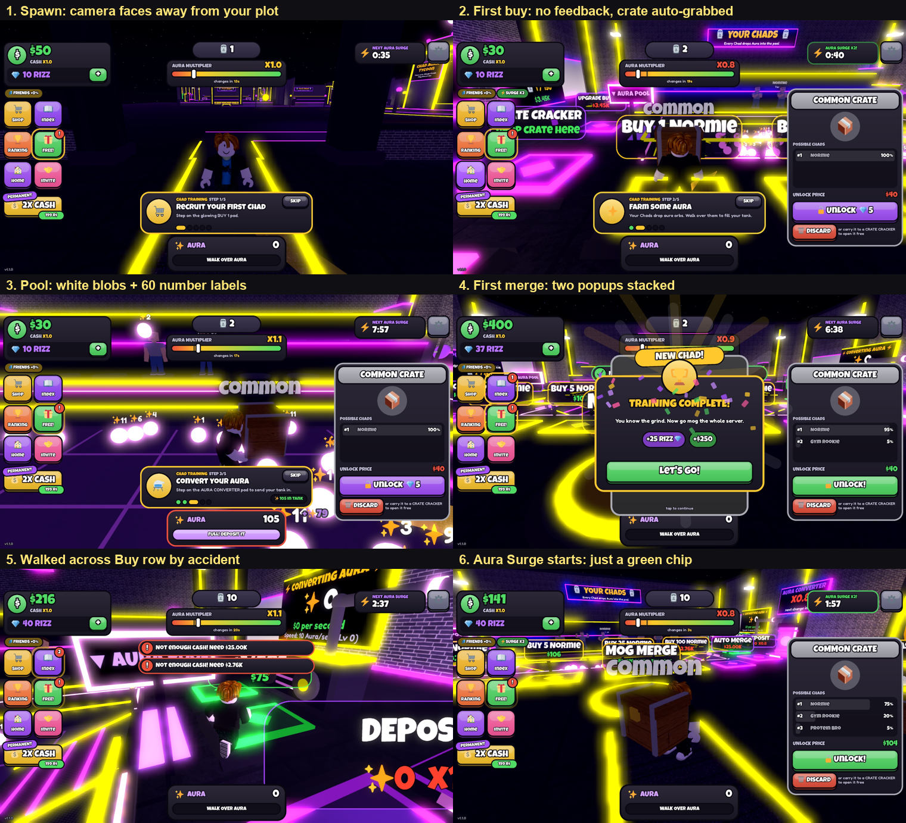

> Historical working note from 2026-10-06. It no longer matches the game;
> see README.md for the current design.

# Chad Aura Tycoon: playtest report (2026-10-06)

Played in Roblox Studio (Play solo, fresh profile), driven through Studio's MCP tools: walking with
Humanoid:MoveTo, clicking real HUD buttons, and capturing frame bursts around every action.
Session: spawn → tutorial → buy → farm pool → deposit → collect → merge ×2 → crate unlock →
Crate Cracker → processing upgrade → Index/Shop → Aura Surge start.

## Verdict

The loop works and the UI kit is clean, but the game feels flat. Almost every action answers with a
sound plus a small 2D number. The 3D world never reacts. Buying, merging, depositing and
upgrading change a label and nothing else. The most important moments (first merge, new tier, a
Surge) are either hidden behind popups or not announced at all. The scene is also so busy with
neon and billboard text that the few things that do move get lost.

## What's wrong (from playing)

### Bugs and friction
1. **Spawn camera faces the wrong way.** The character spawns facing the plot (+Z) but the camera
   looks −Z. Your first frame shows your character's face and the empty, dark hub. (Pressing Home
   later frames it correctly.)
2. **Pads fire by accident.** The Buy row sits in the main walkway. Walking from the Crate Cracker to
   the upgrade pad bought 5 Normies (units 4 → 10, −$124) and set off two "Not enough cash" toasts
   (Auto Merge $25K, Buy 100). Players will spend money they didn't mean to.
3. **Crates get picked up just by walking past them.** I grabbed one on the way to my first Buy pad
   and another on the way to merge. Each one opens a large side panel, and the held crate sits over
   the character's head and blocks the camera.
4. **Two popups at once on the first merge.** "NEW CHAD!" and "TRAINING COMPLETE!" pop at the same
   moment, stacked. The two best rewards in the first minute step on each other.
5. **The "FULL! DEPOSIT IT" tank label is cosmetic.** The capacity is `production × 30` on the client
   only (`Hud.luau:525`). The server never caps it, so the label says FULL at 105 and the number
   keeps climbing to 172.
6. **The pool dies when you're away.** It caps at `MAX_ORBS = 60` (`Tycoon.luau:62`). After that no
   new orbs fall and existing orbs only grow their number label, so a pool you come back to is a
   frozen field of white blobs.
7. **Crate value is backwards.** A Common crate costs $40 to unlock and rolls Normie 95–100%. Buying
   a Normie costs $20.
8. **Sound is broken in Studio.** `rbxasset://sounds/swoosh.wav` fails to load ("Asset is not
   approved"), 11× in one session. Deposit, Merge, Open and Close all use it, so they are silent
   (`Sounds.luau:12-28`).
9. Minor: the top-centre counter (1→2→3→4→10) has no label explaining what it counts. The Index
   viewports pop in one at a time. The Crate Cracker timer text hides behind your head.

### Visual readability
- **Neon overload.** Every edge, rail, pad and wall trim is bright yellow or magenta neon with heavy
  bloom. At default zoom the guide beam and rail glow fill half the screen. Nothing reads as
  important because everything glows.
- **Billboard soup.** Pad signs ("BUY 1 NORMIE", "MOG MERGE", "DEPOSIT", "CRATE CRACKER"), crate
  labels ("common") and the "VIP CRATE CRACKER / Game Pass" sign float at head height and overlap
  the character, each other and the HUD. The VIP sign fills the whole screen when you walk past.
- **The orbs don't look like aura.** They are flat white neon balls that blow out to blobs, each with
  a "+11" label, up to 60 labels at once.
- **The shelf feels empty and dark.** One or two small units stand on a huge, unlit 3-tier stand. The
  units (the thing you're collecting) are the least lit objects on the plot.
- **Tiers 1–9 are the same blocky body with a different shirt.** Tier 2 is no bigger than tier 1.
  Only tiers 10+ gain glow, wings or particles.

## Juice audit: each action vs. what it should feel like

| Action | What happens now | What it should do |
|---|---|---|
| Buy unit | Cash ticks down, "click" sound. The unit model appears on the shelf with no animation. `refreshDisplay` destroys and rebuilds the tier's first model whenever its count changes, so it flickers and resets its pose. | Pad presses down and flashes. A light beam or portal drops the unit onto its podium with squash-and-stretch, a dust ring, a pop sound and a "+1 Normie" float. Only add or remove models, never rebuild them. |
| Orbs drop | Server-side tween arc (0.3 s + 0.5 s), replicated choppily. No landing, no sound. Stops at 60. | Client-side arcs with a trail, a small bounce and a splash ring on landing, and a soft tick sound with random pitch. Orbs bob and glow in tier colour. Merge orbs visually past the cap (bigger, brighter orb) so the pool keeps moving. |
| Pick up orbs | Orb destroyed instantly. Sound and float batched once per second. Tank number pops 1.15×. | Magnet: orbs within ~10 studs slide into the character, each with a rising-pitch "combo" blip (pitch resets after 0.5 s idle). Tank bar fills with a liquid wobble. A shine sweeps the bar and it pulses when it's "full". |
| Deposit | Tank snaps to 0, swoosh (broken), small "+120 ×0.7" float. | Orbs stream out of the character into the converter intake (tank bar drains visibly). The converter spins up, glows and hums, and shows the multiplier big if it's good (≥1.5× = gold flash plus "NICE TIMING!"). |
| Converter processing | Nothing in 3D. | Rotating core, pipe pulses travelling to the Collect pad, and a cash stack growing on the Collect pad. |
| Collect cash | Ping, "+$120" float, wallet count-up. | A coin burst flies from the pad to the wallet icon, with each coin landing as a tick. Wallet bounces and the count rolls up. A bigger burst and a short screen shake for big amounts. |
| Merge | Toast plus sound. The two units vanish and the new one appears. The "NEW CHAD" card covers the shelf, so the fusion is never seen. Auto-merge is silent. | The two units float up and spiral into each other, then a white flash, shockwave ring, particle burst and a small camera punch (FOV kick). The new unit lands with a power pose and a "TIER 3!" billboard. Show the card *after* the 3D moment (0.8–1 s delay), with the camera turned towards the shelf. Give auto-merge a lighter version. |
| New tier | The best moment in the game: rays, spinning viewport, victory sound. No confetti, no camera. | Keep the card, plus confetti, a rarity-coloured burst and a stinger sound per rarity. Legendary and Mythic get a short cinematic: camera orbits the unit on the shelf for 1.5 s. |
| Crate open | Reward card appears instantly. | Crate shakes (3 rising hits), lid bursts, a rarity-coloured beam shoots up, and the unit rises out. Add a short "roll" through the possible units before it lands. Rarity sets the colour and sound. |
| Crate Cracker | Crate disappears into a text timer. | Crate sits on the cracker, rattling and glowing more as the timer runs, then bursts open with a "READY!" marker visible across the plot. |
| Upgrade (+/sec, Buy Tier, Auto Merge) | Toast plus reward sound. | Pad level-up burst, converter visibly upgrades (extra ring or brighter colour per level), "LV 2" float. Buy Tier: the Buy-pad signs flip to the new unit with a card-flip animation. |
| Multiplier re-roll | Gauge snaps, no sound. | Slot-machine spin on the needle (0.6 s), tick sounds, and a coloured flash when it lands high. The converter colour follows the multiplier. |
| Aura Surge | The timer chip turns green. That's all. | Siren or bass-drop sting, full-screen "AURA SURGE ×2!" banner, sky and lighting shift to gold/purple, orbs change colour, and the pool sparkles for its duration. A countdown pulse in the last 10 s. |
| Units idle | 9 blended poses, the same tempo at every tier. | Tempo and "power" scale with tier: high tiers flex, float or emit an aura. Every few seconds a random unit does a showy pose. Give each unit a soft spotlight and a rarity-coloured podium glow. |

## Priorities (biggest feel-gain per hour of work)

1. **Fix the friction:** spawn camera, pad placement (move Buy and Auto Merge out of the walkway, or
   require standing still for 0.3 s), auto crate pickup (use a ProximityPrompt or walk-over plus
   confirm), popup queue (one at a time, priority order).
2. **Merge moment:** fly-together fusion, flash, shockwave, camera punch, then the card. This is the
   core verb and today it's invisible.
3. **Orb magnet + combo pitch + client-side orb visuals.** You do this action most often. Make it
   feel like vacuuming candy.
4. **Collect coin burst to the wallet + deposit stream into the converter.**
5. **Sound pass:** upload or approve your own sounds (one per event, pitch-varied) and add a fallback
   so a failed asset never silences an action.
6. **Visual hierarchy:** cut neon by ~60% (keep it on interactable pads and the converter), shrink
   pad billboards and only show them close up, light the shelf, and make the units the brightest
   thing on the plot.
7. **Surge and multiplier events:** announcement banner, lighting shift, needle spin.
8. **Crate reveal sequence** and **tier-scaled unit animation and size**.

## Technical notes for implementation

- Move all cosmetic VFX to the client. The server should only send `effect(kind, data)` (the
  pipeline exists: `Tycoon.luau:139` → `Main.client.luau:138-157`). Orb arcs are currently server
  tweens (`Tycoon.luau:477-508`), which is why they look choppy.
- `refreshDisplay` (`Tycoon.luau:230`) should diff the shelf and animate added and removed units
  instead of destroying and rebuilding. Send merge source/target slot indices in the `Merge` effect
  so the client can play the fusion.
- Build VFX from ParticleEmitters, Beams and Attachments plus TweenService. Bake sprite sheets
  (sparkle, shockwave ring, coin) in Blender if you want them to look premium.
- Add a `Popups` queue so Reward, Tutorial and Offline cards never overlap.
